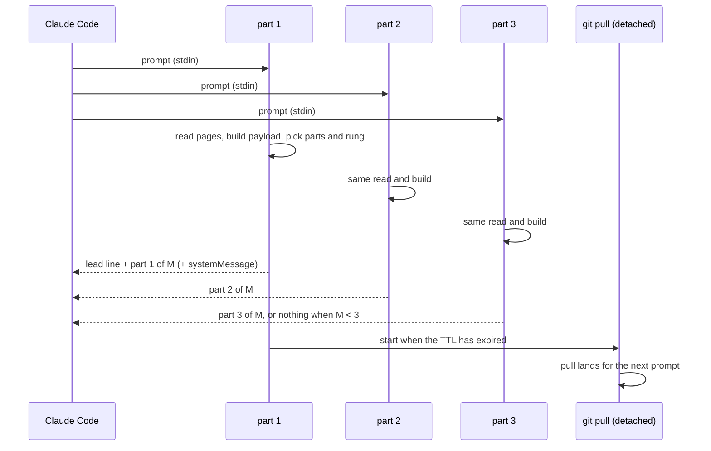

# Split the handbook maps across prompt hooks - Plan

## Goal Capsule

- **Objective:** a team handbook can keep adding registry rows without its size check going red, and every session still receives every row and the registry page's rules.
- **Means:** the prompt hook is registered several times and each registration sends one slice of the same maps payload (KTD1, KTD2).
- **Authority:** the Product Contract requirements win on behavior; the KTDs win on mechanism.
- **Execution profile:** one pull request in this repo, released as scripta 0.18.0.
- **Stop conditions:** stop and ask if a live Claude Code run shows a part offloaded to a file, or parts arriving in a way the model cannot reassemble.
- **Who ships:** the implementer opens the PR; a human reviews and merges.

---

## Product Contract

### Summary

`hooks/load_scripta_on_prompt.py` is registered three times in `hooks/hooks.json`, each with `--part k`. Every registration builds the same maps payload and prints only its own slice, each slice at most 9,000 bytes and cut between lines. The payload uses as few parts as it needs, so a handbook that fits one part today still arrives as one part. `--check-maps` passes while every registry row and the page's rules fit in the three parts.

### Problem Frame

Claude Code caps each hook text at 10,000 characters and swaps a longer one for a file path and a 2,000-character preview. scripta keeps the maps payload under `MAX_BYTES = 9_000` for that reason. A large team handbook's registry gains about one row a week (about 150 bytes), so its Registry size check failed on its main branch on 8 and 9 November 2026 and every PR that touched the registry failed with it. Trimming rows buys a few weeks each time.

Claude Code measures each hook's text on its own, even when several hooks run for the same prompt. A run on 2026-11-09 confirmed it: three 9,477-character hook texts all arrived inline, and one 12,000-character text was offloaded.

### Requirements

**What a session receives**

- R1. Every registry row and the registry page's rules reach the session whole while that content fits in `MAP_PARTS` parts of at most `MAX_BYTES` each.
- R2. A session receives no more parts than the payload needs: the fewest parts that carry R1, and within that count the most complete rung of the existing size ladder.
- R3. All parts a session receives in one prompt come from the same version of `index.md` and `where-truth-lives.md`.
- R4. When the maps need more than one part, each part names its position (part k of M) and a short version of the whole payload, so a part that failed to arrive, or parts built from two versions of the pages, are visible to the model instead of silently missing or repeating rows.

**The size check**

- R5. `--check-maps` exits 0 while R1 holds, and 1 when it does not, and its message names the parts used, the largest part's bytes, and the rung.

**Compatibility**

- R6. The hooks run on Python 3.9 on macOS, Linux and Windows, and never crash or block a prompt.

### Scope Boundaries

- Not changing what the ladder rungs drop, the trigger regex, or the SessionStart hook's own pull.
- Considered and not built: a shared per-prompt snapshot file that all parts read. It would also cover a pull from another session landing in the same instant. That race needs another session's pull to land within the ~100 ms the parts take to read, and it fixes itself on the next prompt. A report of mismatched parts would change the call.
- Considered and not built: a CI warning for sessions still on scripta 0.17.0 or older. Those sessions keep today's single 9,000-byte payload and its own warning to the person; the release note covers it.
- Considered and not built: repeating the registry page's prose in every part. Only the table header row repeats (KTD4).

### Deferred to Follow-Up Work

- In the handbook that calls the maps-budget action: update the comment in its `.github/workflows/registry-size.yml`, which still describes one 9,000-byte cap.
- Tell the team to update the scripta plugin to 0.18.0, since old installs do not get the extra parts.

---

## Planning Contract

### Key Technical Decisions

- KTD1. **Fixed registrations, one constant.** `MAP_PARTS = 3` lives in `hooks/load_scripta_context.py`, and `hooks/hooks.json` carries exactly `MAP_PARTS` UserPromptSubmit entries passing `--part 1` to `--part 3`. A test keeps the two in step. Claude Code has no way for one hook command to emit several texts, so the count has to be static. Adding a fourth part later is one entry plus the constant.
- KTD2. **Each part rebuilds and slices.** Every invocation builds the full payload with the existing ladder, then splits it greedily on line boundaries into chunks of at most `MAX_BYTES`. Lines are table rows, so a row is never cut. The split is deterministic, so the same files give the same slices in every process.
- KTD3. **Fewest parts first, then the best rung.** The ladder now asks, for part counts 1 to `MAP_PARTS`, which is the first count where some rung up to 4 fits, and within that count picks the lowest rung that fits (R2). If no count holds rung 4, rung 5 is tried in `MAP_PARTS` parts, then the existing tail cut on the last part. This keeps today's one-part payload and grows the text a session gets only as the registry grows.
- KTD4. **Who carries what.** Part 1 carries the existing lead line, the handbook header and, when not ok, the `systemMessage` to the person. The last part carries the rung's note. When the payload needs more than one part, every part opens with one line naming part k of M and an 8-character hash of the unsplit payload, and saying to read `where-truth-lives.md` if a part is missing or the versions differ. A single part carries no such line, since nothing can go missing from it. A part that starts inside the registry table repeats the table's header row, and the separator unless the part starts on it. A part whose k is above M prints nothing.
- KTD5. **The pull moves after the read, in the background.** Today the prompt hook runs `freshen()` (a `git pull` of up to 15 s) before reading. With several parts that would let part 1 read the new files while the others read the old ones. Now no part pulls before reading; part 1, after printing, starts a detached `--freshen <repo>` run when the TTL has expired, using the same detached-spawn pattern as `maybe_refresh_links()`. The pull lands for the next prompt. The first team-fact prompt after the TTL may therefore see maps up to one TTL old, which the SessionStart pull already bounds at session start. This closes the race between the parts of one prompt (R3) and also takes the pull off the prompt's critical path.

### High-Level Technical Design

### Assumptions

- Claude Code keeps measuring each hook's `additionalContext` on its own, as its hooks docs state and the 2026-11-09 run showed.
- The parts of one prompt start within about 100 ms of each other, well before a network `git pull` changes files.

---

## Implementation Units

### U1. Split the payload into parts and choose the part count

- **Goal:** `load_scripta_context.py` returns the maps as a list of parts that satisfy R1, R2 and R4.
- **Requirements:** R1, R2, R4, R5
- **Dependencies:** none
- **Files:** `hooks/load_scripta_context.py`, `hooks/test_load_scripta_context.py`
- **Approach:**
  1. Add `MAP_PARTS` and a line-boundary splitter that respects `MAX_BYTES` per part, including each part's own k-of-M line and any repeated table header (KTD2, KTD4).
  2. Rework the rung loop in `_assemble_maps` into the part-count-then-rung search of KTD3. Keep the rung functions and notes as they are.
  3. Extend `maps_payload_report` with the parts list, the part count and the largest part's bytes. Keep `body` as the unsplit payload, so existing callers and tests that read `body` still work.
  4. Update `check_maps_cli` messages to name parts used, largest part and rung (R5).
- **Patterns to follow:** the existing ladder and its `RUNG_NAMES`; `CheckMapsCli` and `MapsReport` tests.
- **Test scenarios:**
  - A small handbook gives one part at rung 1 with no position line.
  - A registry that fits one part only at rung 4 still gives one part at rung 4, not two parts at a better rung.
  - A registry too big for one part at rung 4 gives two parts, and every fact cell appears exactly once across them.
  - A registry needing three parts gives three, and every part is at most `MAX_BYTES` bytes.
  - No row is cut or repeated: with each part's k-of-M line and any repeated table header removed, the parts concatenate to the unsplit payload.
  - A part that starts inside the table opens with the table header and separator rows.
  - A registry too big for `MAP_PARTS` parts at rung 4 is not ok, and one too big even at rung 5 ends in the tail cut with its notice on the last part.
  - `--check-maps` exits 0 with a message naming "1 of 3 parts" on a small handbook, and 1 with the needed size when even three parts are not enough.
- **Verification:** the hook tests pass. `--check-maps` on a handbook that fits one part at rung 4 reports one part, and on a handbook too big for one part at rung 4 it reports two parts and exits 0.

### U2. Emit one part per invocation and move the pull

- **Goal:** each registration of the prompt hook prints its own part, and no part pulls before reading.
- **Requirements:** R3, R4, R6
- **Dependencies:** U1
- **Files:** `hooks/load_scripta_on_prompt.py`, `hooks/load_scripta_context.py`, `hooks/test_load_scripta_on_prompt.py`
- **Approach:**
  1. Parse `--part k` from argv; a missing or malformed value means part 1.
  2. After the trigger match, build the report once and print part k as `additionalContext`, with the lead line and `systemMessage` on part 1 only (KTD4). Print nothing when k is above the part count.
  3. Remove the `freshen()` call before the read. In part 1, after printing, start the detached `--freshen` run when the TTL has expired (KTD5). Add the `--freshen <repo>` entry point to `load_scripta_context.py`, calling the existing `freshen()`.
- **Patterns to follow:** `maybe_refresh_links()` for the detached spawn on POSIX and Windows; the `WarnsThePerson` tests for driving `main()`.
- **Test scenarios:**
  - With three parts available and a payload of two parts, `--part 1` prints the lead line and "part 1 of 2", `--part 2` prints "part 2 of 2", and `--part 3` prints nothing.
  - Only part 1 carries `systemMessage` when the maps are not ok.
  - A non-matching prompt prints nothing for every part and touches no file.
  - No part calls `freshen()` before reading the pages.
  - Part 1 starts the detached pull when the TTL marker is stale, and starts nothing when it is fresh; parts 2 and 3 never start it.
  - A failing spawn is swallowed and the part's output is unchanged.
  - A malformed `--part` value behaves as part 1.
- **Verification:** the hook tests pass on the CI Linux job and the Python 3.9 job.

### U3. Register the parts and release

- **Goal:** installed plugins run three parts, and the docs describe it.
- **Requirements:** R1, R6
- **Dependencies:** U2
- **Files:** `hooks/hooks.json`, `.claude-plugin/marketplace.json`, `docs/reference.md`, `hooks/test_load_scripta_context.py`
- **Approach:**
  1. Replace the single UserPromptSubmit entry with `MAP_PARTS` entries passing `--part 1` to `--part 3` (KTD1).
  2. Bump the scripta plugin version from 0.17.0 to 0.18.0 in `.claude-plugin/marketplace.json`.
  3. Update the knowledge-hooks section of `docs/reference.md` and the module docstrings: the parts, the per-part cap, and the pull now running after the read.
- **Test scenarios:**
  - `hooks/hooks.json` has exactly `MAP_PARTS` UserPromptSubmit commands, and command k passes `--part k`.
  - The existing guard still holds: `MAX_BYTES` plus the lead line stays under 10,000 characters.
- **Verification:** a live Claude Code run with this plugin version, against a copy of the handbook grown to need three parts, shows the model the last registry row and "part 3 of 3", and no part is offloaded to a file.

---

## Verification Contract

| Check | How | Proves |
|---|---|---|
| Hook tests | `python3 -m unittest -v test_load_scripta_context test_load_scripta_on_prompt` in `hooks/` | U1, U2, U3 behavior |
| Python 3.9 | the `digest-schedule` CI job, which reruns the hook tests on 3.9 | R6 |
| maps-budget action | the existing CI steps that run it on the fixture and on a new handbook | `--check-maps` still exits 0 on small handbooks |
| Real handbook | `--check-maps` on a real handbook checkout, before and after trimming it under one part | two parts and exit 0 while it is too big for one part, one part once it fits (R1, R2) |
| Live session | `claude -p` loading this plugin version, against a handbook copy that needs three parts | every part arrives inline, and the model can quote the last row (R1, R4) |

## Definition of Done

- U1 to U3 are done and their test scenarios pass locally and in CI.
- The live session check passed, with its prompt and result written in the PR.
- No leftover code from abandoned approaches is in the diff.
- The PR names the two follow-ups under Deferred to Follow-Up Work.
